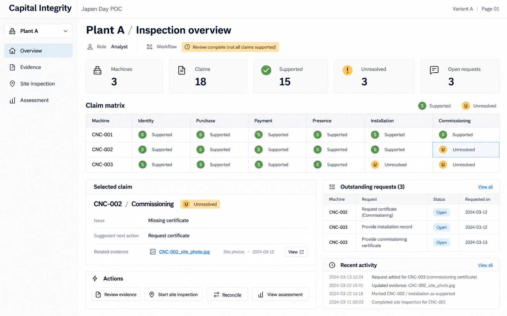
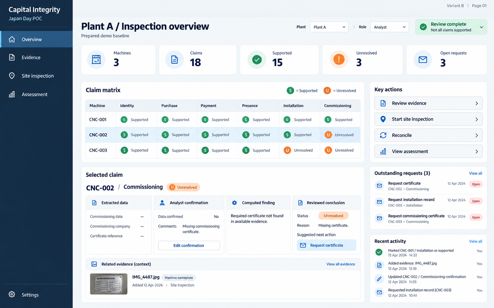
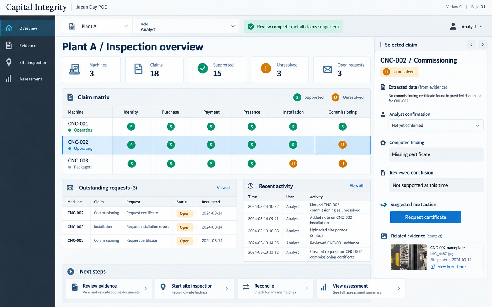
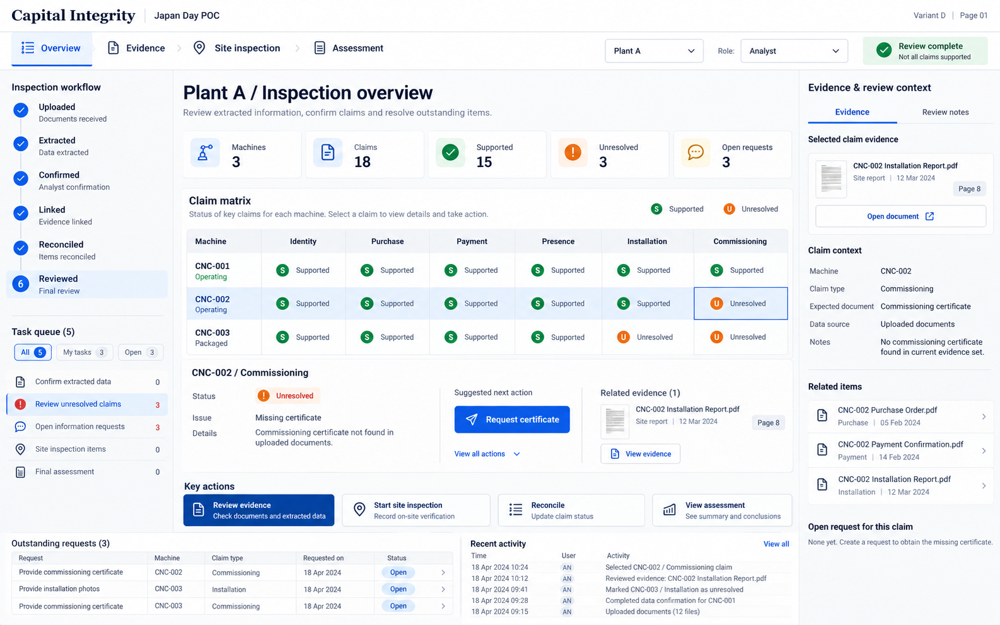
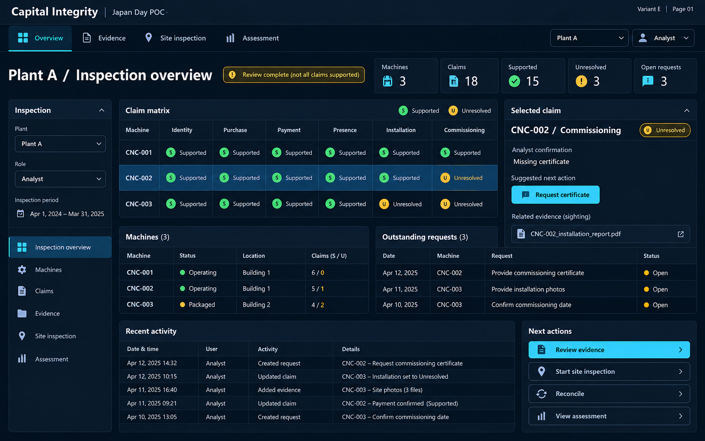

# Inspection overview — five layout options

[All pages](README.md)

These are visual concepts using prepared demo data, not application screenshots. For page 01, compare the organization of the same core functions across five density levels.

What to compare:

- Is the six-claim matrix easy to scan?
- Can you identify unresolved claims and the next action quickly?
- Are inspection review completion and claim support clearly different?

## A — Minimal notebook

[Open full-size image](images/A-01.png)

## B — Clean product dashboard

[Open full-size image](images/B-01.png)

## C — Evidence-first split workspace

[Open full-size image](images/C-01.png)

## D — Guided workflow cockpit

[Open full-size image](images/D-01.png)

## E — Dense operations dashboard

[Open full-size image](images/E-01.png)
