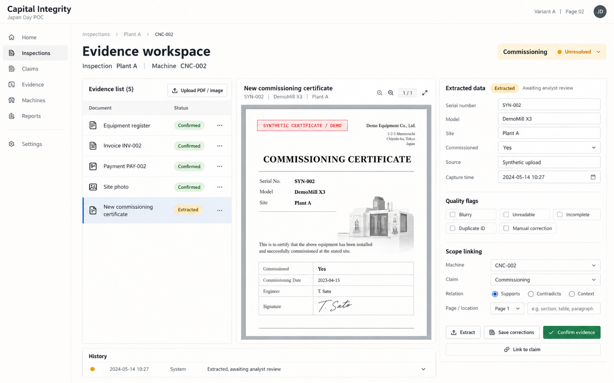
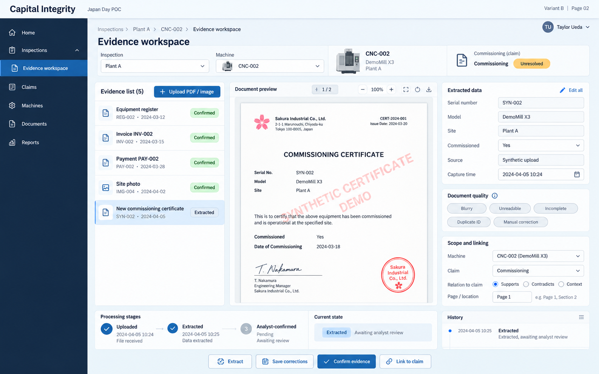
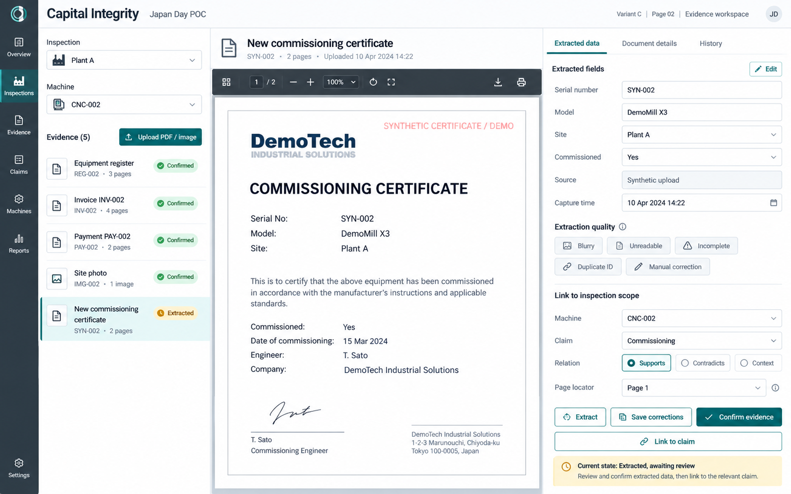
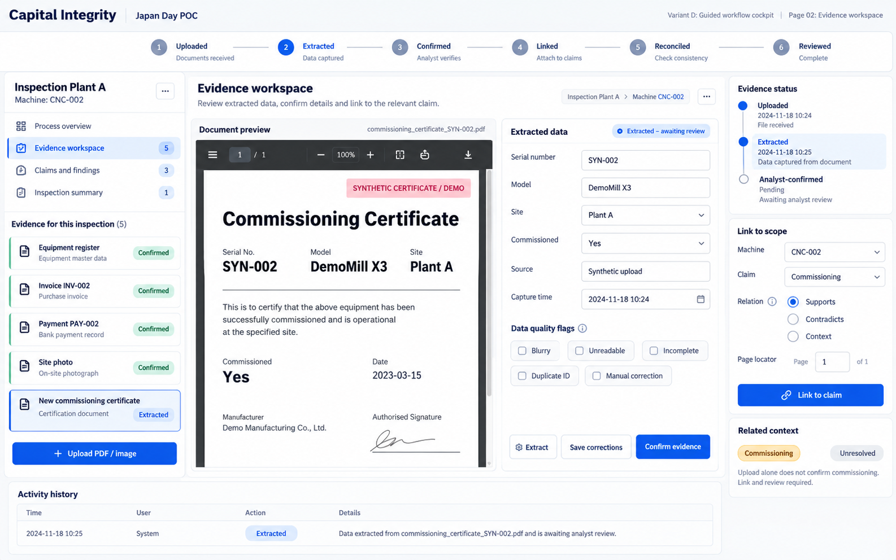
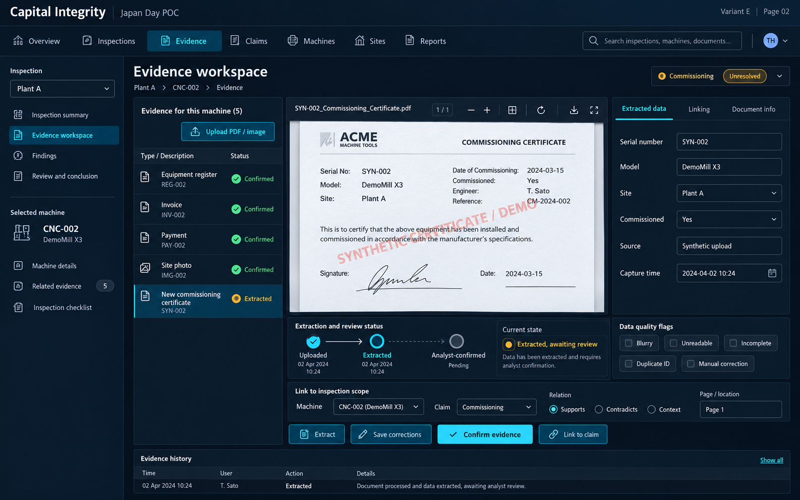

# Evidence workspace — five layout options

[All pages](README.md)

These are visual concepts using prepared demo data, not application screenshots. For page 02, compare the organization of the same core functions across five density levels.

What to compare:

- Can you compare original evidence with editable fields without switching screens?
- Are extraction, analyst acceptance and claim linking distinct?
- Are quality flags and earlier edits accessible without crowding the main task?

## A — Minimal notebook

[Open full-size image](images/A-02.png)

## B — Clean product dashboard

[Open full-size image](images/B-02.png)

## C — Evidence-first split workspace

[Open full-size image](images/C-02.png)

## D — Guided workflow cockpit

[Open full-size image](images/D-02.png)

## E — Dense operations dashboard

[Open full-size image](images/E-02.png)
