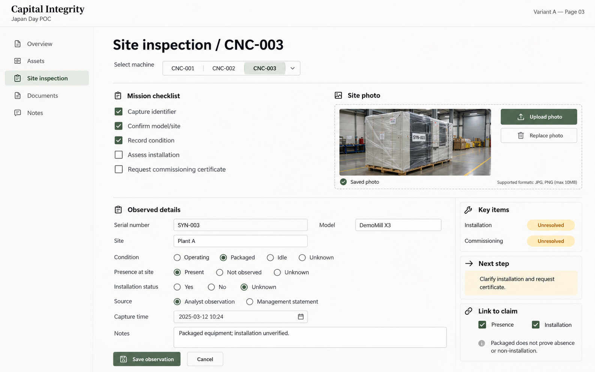
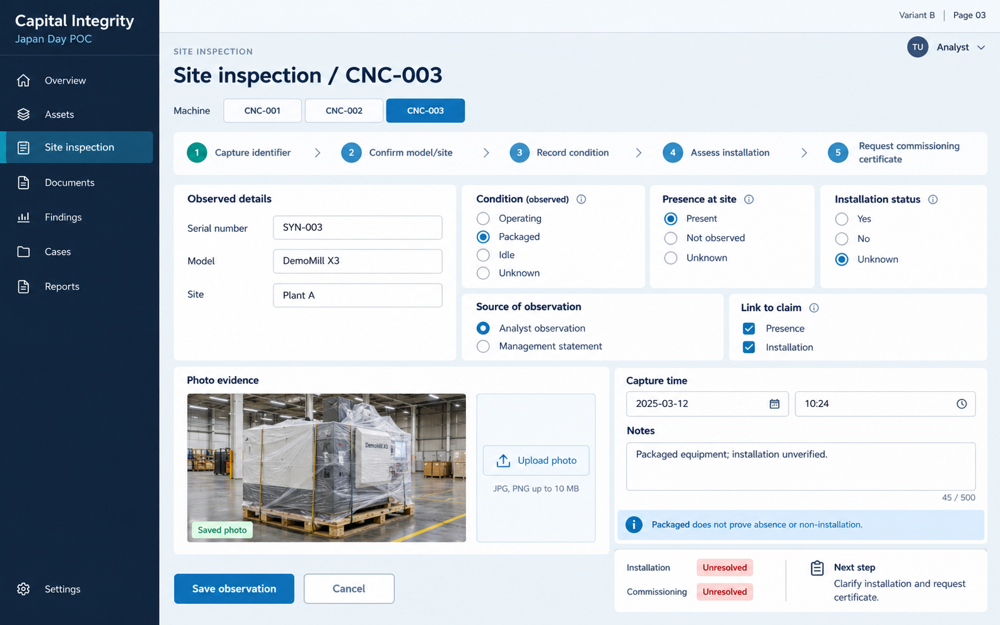
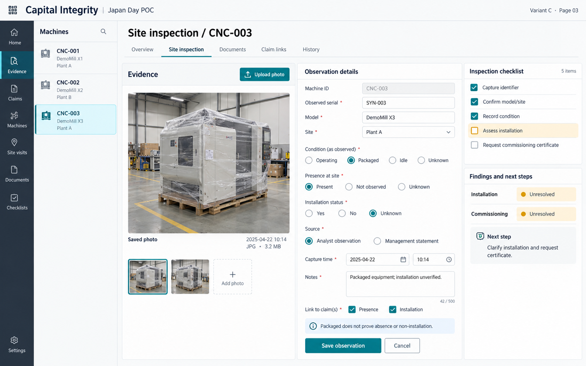
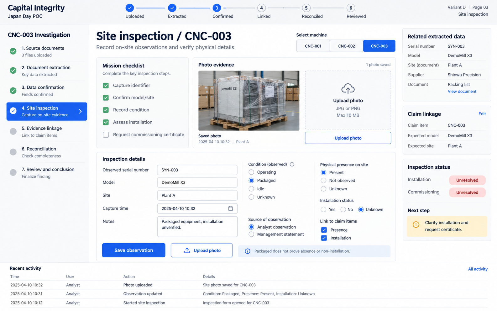
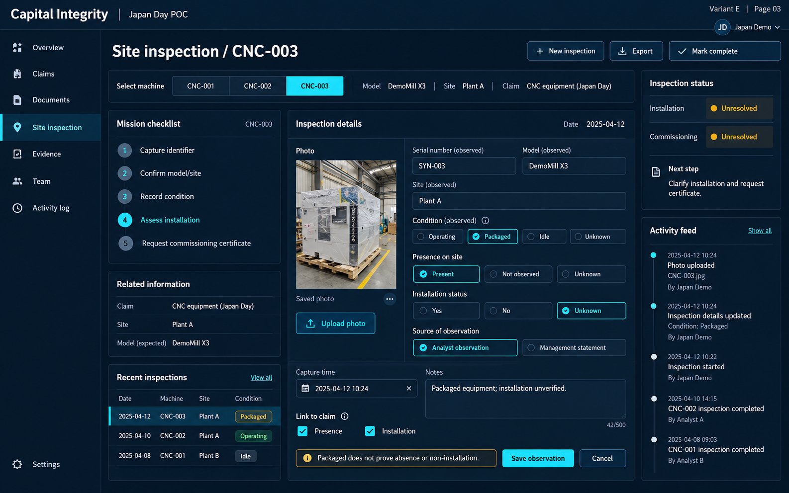

# Site inspection — five layout options

[All pages](README.md)

These are visual concepts using prepared demo data, not application screenshots. For page 03, compare the organization of the same core functions across five density levels.

What to compare:

- Can you record packaged/unknown conditions without implying an accusation?
- Are photo, identifier, condition, notes and capture time visible together?
- Does the checklist support a field visit rather than duplicate the report screen?

## A — Minimal notebook

[Open full-size image](images/A-03.png)

## B — Clean product dashboard

[Open full-size image](images/B-03.png)

## C — Evidence-first split workspace

[Open full-size image](images/C-03.png)

## D — Guided workflow cockpit

[Open full-size image](images/D-03.png)

## E — Dense operations dashboard

[Open full-size image](images/E-03.png)
