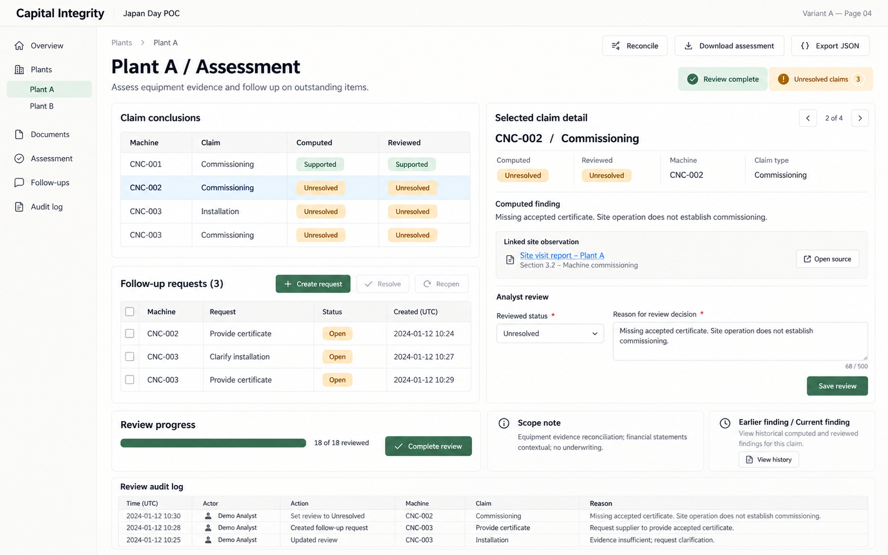
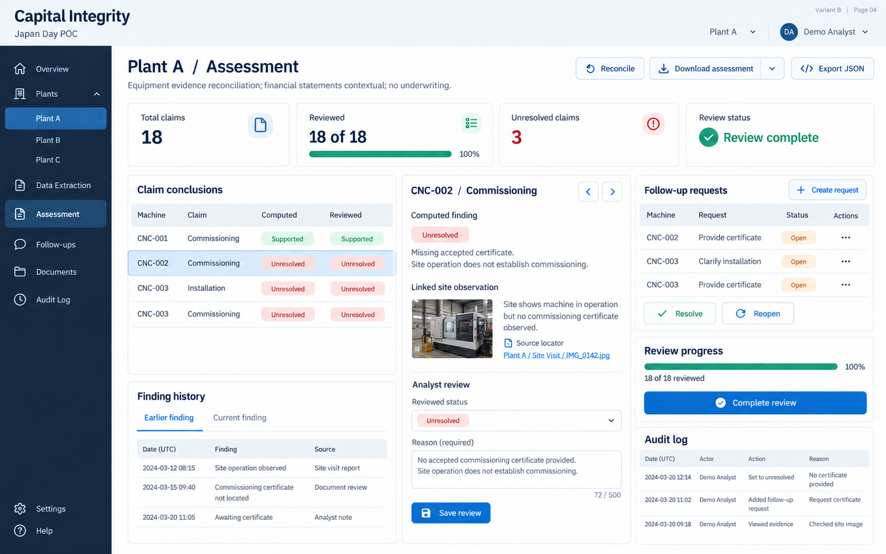
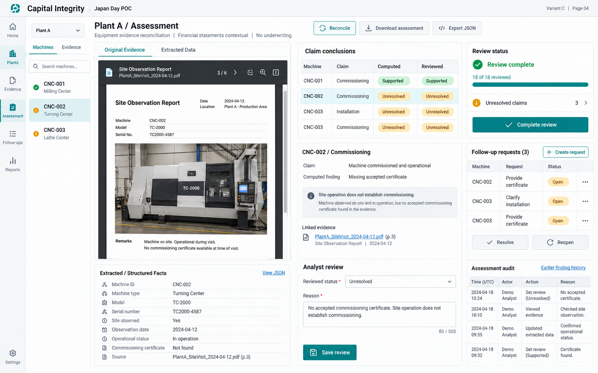
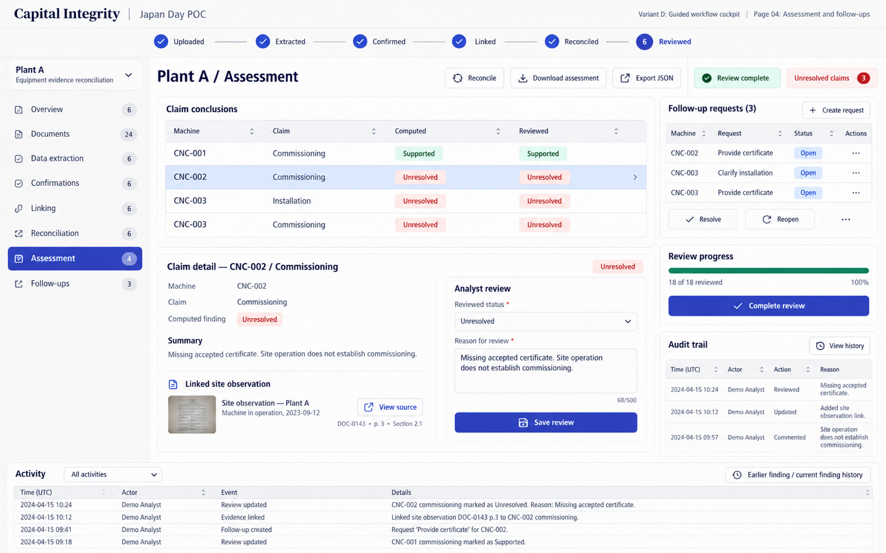
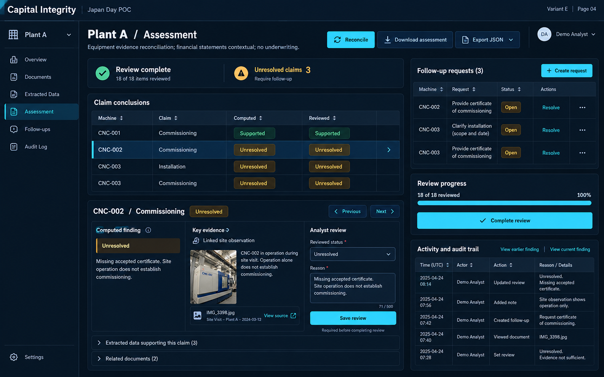

# Assessment and follow-ups — five layout options

[All pages](README.md)

These are visual concepts using prepared demo data, not application screenshots. For page 04, compare the organization of the same core functions across five density levels.

What to compare:

- Can you distinguish computed from reviewed conclusions?
- Can you open linked evidence and follow-up actions from the finding?
- Are unresolved items, report exports and the historical record easy to find?

## A — Minimal notebook

[Open full-size image](images/A-04.png)

## B — Clean product dashboard

[Open full-size image](images/B-04.png)

## C — Evidence-first split workspace

[Open full-size image](images/C-04.png)

## D — Guided workflow cockpit

[Open full-size image](images/D-04.png)

## E — Dense operations dashboard

[Open full-size image](images/E-04.png)
