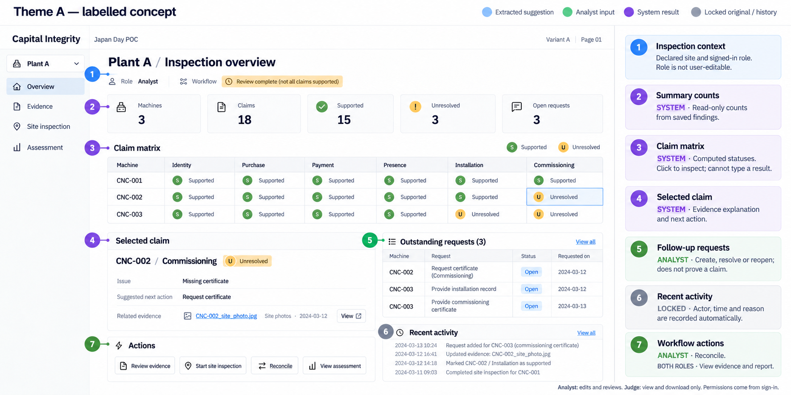
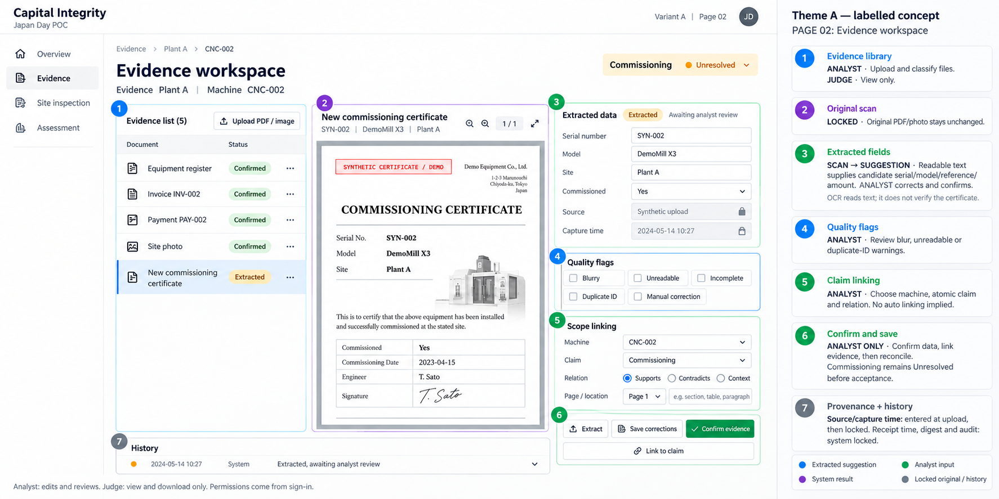
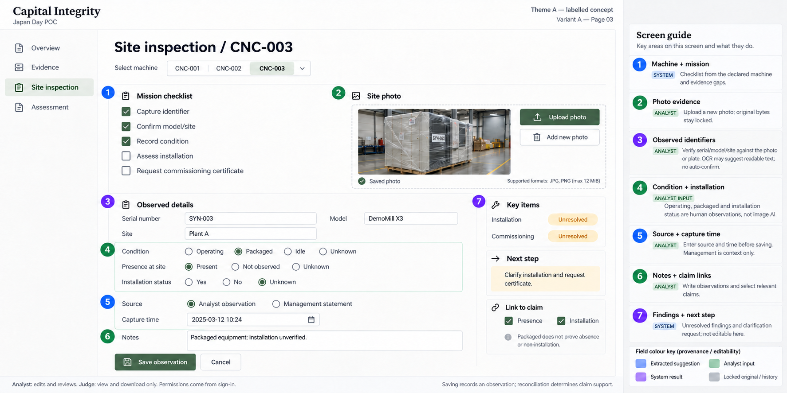
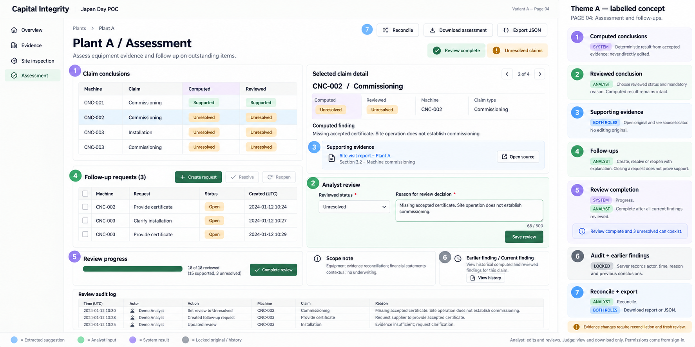

# Simple Theme A — labelled screen guide

Four labelled versions of the same simple Theme A design explain what each section does, where information comes from, and who can edit it. These are explanatory mockups, not implemented frontend screens. They use the prepared trial baseline (18 claims: 15 supported, 3 unresolved); the current live Plant A example has 16 supported and 2 unresolved after the certificate test.

## Read the labels

| Label | Meaning | Editing access |
|---|---|---|
| Blue — extracted suggestion | Text read from a PDF or by OCR, mapped into candidate fields where possible | Analyst checks/corrects the working extract; judge reads only |
| Green — analyst input | Human observation, correction, evidence acceptance, claim link, reviewed conclusion or follow-up action | Analyst writes; judge reads only |
| Purple — system result | Counts, computed finding, explanation, checklist guidance, next action and review progress | Calculated by backend; neither role directly edits a computed result |
| Grey — locked original/history | Original file, integrity digest and recorded audit events | Both roles can view; neither role can overwrite through the API |

The numbered circles refer to numbered explanation cards. Permission tags and field labels are authoritative; the numbers themselves do not grant access.

There are only two application roles in this backend: **analyst** and **judge**. There is no additional inspector, borrower, manager or admin editing role. The signed-in credential determines permissions. A role label or dropdown must never let someone grant themselves analyst access. Both roles can read the demo team's inspections and download available originals/reports; only analysts can call write operations.

## 1. Inspection overview

| Number | Section | Source and purpose | Editable? |
|---|---|---|---|
| 1 | Inspection context | Declared site/inspection plus credential-derived role | Both can select an inspection to view; role is not self-editable. Analysts correct declarations through the audited asset form. |
| 2 | Summary counts | Backend counts of machines, findings and requests | Read-only |
| 3 | Claim matrix | Backend's computed result for six atomic claims per machine | Click to inspect; no direct editing of status |
| 4 | Selected claim | Backend explanation, linked evidence and next action | Read-only here; analyst changes evidence or separately records a reviewed conclusion |
| 5 | Follow-up requests | Saved requests and their lifecycle state | Analyst creates/resolves/reopens with reasons; judge reads |
| 6 | Recent activity | Server-recorded actor/time/reason and changes | Read-only |
| 7 | Actions | Navigate, request reconciliation or view assessment | Reconciliation is analyst-only; viewing is available to both |

## 2. Evidence workspace

| Number | Section | Source and purpose | Editable? |
|---|---|---|---|
| 1 | Evidence library | Uploaded documents/images with their extraction and acceptance state | Analyst uploads/classifies at import; both roles open files |
| 2 | Original scan | Exact original PDF/photo bytes, digest-checked | No overwrite; corrections never change the source file |
| 3 | Extracted fields | Candidate serial/model/site/reference/amount/currency or certificate text read from the selected source | Analyst corrects text and facts, then accepts/rejects; judge reads |
| 4 | Quality flags | Extraction failure flags and analyst assessments such as blurry/unreadable/duplicate ID | Analyst reviews and updates; changes audited |
| 5 | Claim links | Analyst's machine/atomic claim/relation/locator assignment | Analyst creates or retracts links; judge reads |
| 6 | Confirmation/actions | Extract, save corrected working text/facts, accept, and link | Analyst-only. Extracted does not mean accepted; accepted evidence still requires reconciliation. |
| 7 | Provenance/history | Source/capture time entered at upload; receipt time, digest and immutable events recorded by system | Source/capture time are locked after upload in current backend; actor/receipt/digest/audit are never user-editable |

### What scanning actually provides

| Information | Can it come from a scan? | What the analyst must do |
|---|---|---|
| Serial/model on a readable plate or document | OCR/PDF text can read candidate text | Compare to original; correct OCR errors; confirm. Blurry or duplicated serials need clarification. |
| Invoice/payment reference, amount and currency | Readable document text may supply candidates | Verify against original and place fields correctly; matching is not live bank verification. |
| A written site/location | Only if text contains it | Confirm actual inspection/site association. No automatic GPS/location inference. |
| Certificate saying commissioned | Candidate text/field can be captured | Review the certificate and link it to the right machine/claim. OCR does not authenticate it. |
| Operating/packaged condition, installed state or presence | No automated visual-condition inference in current V1 | Analyst observes and records the condition. OCR reading a word is not physical verification. |
| Supported/unresolved/inconsistent conclusion | Not a scanned field | Backend computes from accepted relevant evidence and rules. |

The current field-mapping adapter handles simple `field: value` text. It is not a general-purpose invoice/table extractor. For arbitrary layouts, extraction provides text and the analyst manually structures/corrects the facts. Missing or uncertain fields must remain uncertain; no auto-confirmation is implied by the mockups.

## 3. Site inspection

| Number | Section | Source and purpose | Editable? |
|---|---|---|---|
| 1 | Machine + mission | Declared machine and deterministic checklist/next actions | Select machine; checklist guidance is generated. Independent saved checkbox completion is not implemented yet. |
| 2 | Photo evidence | Analyst uploads a saved photo | New uploads allowed to analyst; original bytes remain unchanged; do not overwrite an earlier photo |
| 3 | Observed identifiers | Analyst verifies physical plate/model/site; may use readable OCR text as a starting point | Analyst enters/verifies; judge reads |
| 4 | Condition/installation | Human observations: operating/packaged/idle/unknown, presence, installation | Analyst chooses before saving. Packaged is not proof of absence or non-installation. |
| 5 | Source/capture time | Analyst records observation source and actual time | Enter before saving. A management statement remains contextual even if recorded by an analyst. |
| 6 | Notes/claim links | Human explanation and relevant claim assignment | Analyst writes/selects; original observation payload and later correction history are preserved |
| 7 | Findings/next action | Backend results after reconciliation | Read-only here |

Saving an observation does not itself set a claim to supported. Photo upload and observation recording are existing API operations; integrating a photo's OCR suggestions into this form still requires frontend wiring. No camera streaming or smart-glasses inference is present.

## 4. Assessment and follow-ups

| Number | Section | Source and purpose | Editable? |
|---|---|---|---|
| 1 | Computed conclusions | Deterministic backend status/explanation using accepted linked evidence | Cannot directly edit; correct evidence and reconcile instead |
| 2 | Reviewed conclusion | Analyst's reviewed status and required reason | Analyst writes. It may differ from computed status, but never replaces that computed result. |
| 3 | Supporting evidence | Originals and source locators used to inspect the basis | Both roles open/view; analyst can correct working evidence via workspace, not overwrite original |
| 4 | Follow-ups | Missing-information request and response/resolution | Analyst creates/resolves/reopens. Closing a request never proves a claim. |
| 5 | Review completion | Calculated progress plus analyst's complete-review action | Analyst completes only when every current finding is reviewed and declarations confirmed. Unresolved claims may remain. |
| 6 | Audit/earlier findings | Server-recorded history, previous computed findings and prior reviewed conclusions | Read-only; never manually replace history |
| 7 | Reconcile/export | Backend evaluation and generated report | Analyst reconciles; both roles may download reports/JSON |

An evidence/declaration/link change invalidates current findings. The interface must show that reconciliation and new reviews are required instead of displaying old results as current. The current backend invalidates findings across the inspection, so unchanged conclusions also need re-review after a new evidence basis.

## One example in plain language

1. Upload a commissioning certificate: original is saved and locked.
2. Extract its readable text: serial/model and certificate wording are suggestions, not proof.
3. Analyst compares to original, corrects mistakes, accepts the evidence and links it to CNC-002 commissioning.
4. Reconcile: backend computes whether the commissioning claim is supported.
5. Analyst reviews the computed conclusion and records a reason; resolves the request if satisfied.
6. Judge can see the document, computed/reviewed statuses, assessment and history without editing them.

## Implementation boundaries

These annotations describe roles and data ownership using the current backend contract. They do not claim the frontend, sign-in screen, independent checklist completion, camera integration, document authentication or arbitrary table extraction has been built. Original unlabelled concepts remain unchanged. Field-level access text in this guide takes precedence over decorative generated controls.

Generated with the built-in image-generation tool. Exact prompts and source references are saved in `prompts.json`.
