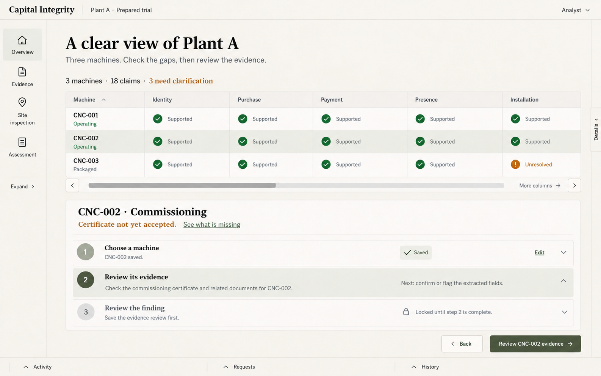
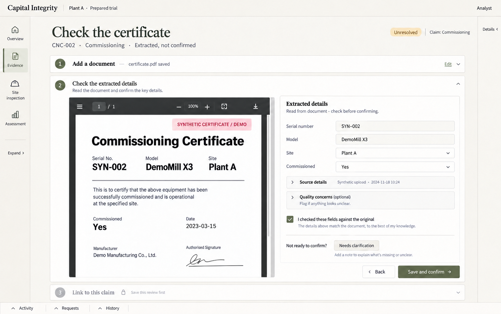
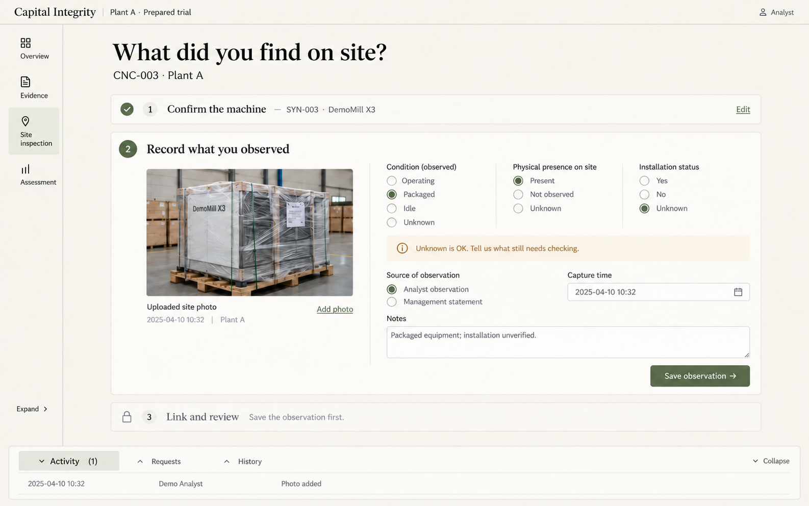
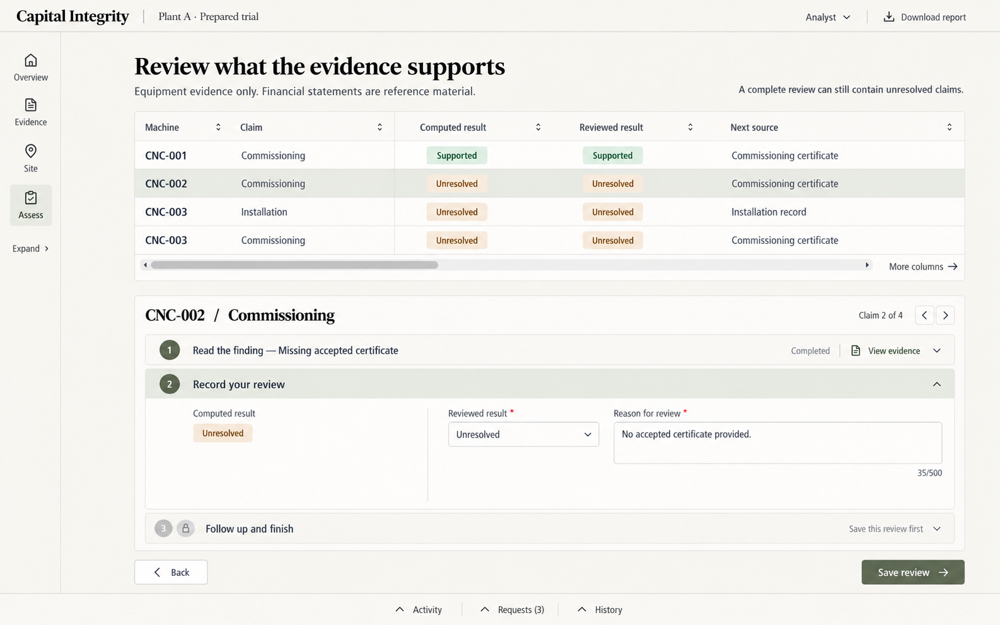

# D — Quiet guide

A softer, less crowded revision of the user's preferred D workflow layout. The request is to keep a clear order of work while making the interface more approachable and less corporate/industrial. These are visual concepts and a behavior specification, not implemented frontend interactions. Existing backend behavior and earlier design options remain unchanged.

## Design decisions

- Warm paper background, warm graphite text, muted olive actions and pale sage selection. Readable dark text stays high contrast; softness must not be achieved by making important text too faint.
- Modest serif task headings paired with readable humanist body text. No geometric-font default, oversized marketing hero, gradient, glow, glass, dark console or decorative animation.
- One dominant task area; no row of KPI cards or grid of equal-sized panels. Use plain inline inspection counts and meaningful whitespace.
- Compact collapsed navigation rail and closed context drawer by default. Expand the one needed panel explicitly; avoid restoring both sidebars automatically.
- Bottom Activity / Requests / History arrow tabs. The tray is collapsed by default, opens only one tab at a time, and has an obvious collapse control. The site screen illustrates a shallow open tray.
- Wide tables scroll horizontally inside their own region. Keep machine/claim labels sticky, retain readable column widths, and expose both a scrollbar and left/right controls. No whole-page horizontal scrolling.
- Saved steps collapse to a one-line summary with an Edit action. Only the active form section is open; later sections remain concise, labelled and disabled until prerequisites are satisfied.
- Use concrete task language and the prepared synthetic Plant A scenario. No fabricated performance charts, bank risk scores, decorative stock illustrations or generic marketing copy.

The provided InterfaceKit excerpt informed the checks for product-specific structure, consistent second screens, useful states and concrete wording. It is not copied into this repository, and the concepts do not infer authorship from a color or font alone.

## Screens

### 1. Overview

The machine/claim table remains the main information surface. Inline totals replace KPI cards. A selected unresolved claim opens one next task. Left navigation, right details and bottom history remain minimized.

### 2. Evidence

The file-upload step is a saved summary. The current extraction-check step shows the original next to a short editable form. Linking is hidden until the review decision is saved. Source/capture metadata are read-only after upload. Needs-clarification is an explicit alternative to accepting bad evidence.

### 3. Site inspection

Machine identification is a saved summary. Human observations are the current task, with one relevant photo and neutral unknown options. Linking stays collapsed until the observation is saved. The shallow Activity tray shows the intended open state without exposing a full-width history table.

### 4. Assessment

A readable, horizontally scrollable table keeps computed and reviewed results separate. The selected finding opens one review form. Follow-up and finish actions appear after saving the review; reports and existing read-only information remain accessible.

## Interaction contract

### Collapsible panels and bottom tabs

- Navigation defaults to a small rail. Its explicit expand/collapse button changes only its width; it never changes the selected inspection or discards inputs.
- Context opens on request and can be dismissed. It must not cover a focused input or silently discard unsaved work.
- Activity, Requests and History form one bottom tray. Selecting a tab opens that panel; selecting its arrow again or Collapse closes it. Switching tabs keeps the same tray rather than stacking panels.
- Empty requests/activity explain their scope (current item versus whole inspection). Do not show invented zero counts or make a filtered zero look like the entire inspection has no follow-ups.
- Keyboard: ordinary tab focus, Enter/Space to toggle, visible focus, Escape to close an overlay. Collapsed controls retain text labels/tooltips and expanded-state announcements.

### Table overflow

- Use a contained horizontal scroller with sticky first Machine column; on assessment keep Machine and Claim identifiable.
- Never shrink headings/values just to make every column fit. Keep an obvious scrollbar/overflow cue and functional left/right controls.
- Arrow actions move the table, not the page. Row selection and scroll position survive opening a drawer.
- On narrow screens, show the same information through a compact machine/claim list and accessible detail view rather than shrinking the desktop matrix into unreadable text.

### Step opening and saving

Gating applies to **the task being edited**, not to all evidence or all supported claims across the inspection. It explains order without concealing existing evidence/results.

| Task | First section | Current/next section | Unlock rule |
|---|---|---|---|
| Overview | Select inspection/machine | Review the selected machine's evidence | A selected machine provides context. This is navigation, not proof of identity. |
| Evidence | Upload original with kind, source and capture time | Extract and check fields; then choose the claim relation | Original must be saved before extraction. A review decision must be saved before advancing. Accepting evidence is distinct from merely saving corrections. |
| Site | Select/verify machine or explicitly flag unclear identity | Record condition, presence, installation, source/time and notes; then link | Save required observations or explicit unknown/clarification responses before opening the linking task. |
| Assessment | Open/read the computed finding and source | Save reviewed status/reason; then follow-up/finish | A current reconciled finding is needed for a review. Complete review additionally uses backend prerequisites, not just a frontend stepper. |

Important exceptions and boundaries:

- Explicit `unknown`, `not observed`, extraction failure or `needs clarification` is a valid recorded response **when applicable**; require a useful reason or follow-up rather than forcing a false positive.
- Evidence that remains unaccepted can proceed to a clarification/context workflow but must not be presented as supporting proof. The backend evaluates accepted relevant evidence only.
- Missing certificate, packaged equipment or an unresolved claim must never deadlock the app. Review can finish with unresolved findings once all declarations are confirmed and current findings reviewed.
- Read-only views of existing evidence, findings, reports and audit history remain accessible. Judges must not be forced through analyst data-entry steps and cannot perform writes.
- Earlier completed sections can be reopened. A changed declaration/evidence/link invalidates existing findings as the backend specifies; display the need to reconcile and re-review. Do not imply subsequent results are still current.
- Unsaved changes need clear save/cancel handling. Failed saves keep the current section open and preserve typed values; never advance optimistically on a failed request.
- No role switching through a visual dropdown. The analyst/judge role comes from credentials; an identity badge may display it but does not grant access.

## Required non-ideal states

- Empty upload: explain supported formats/limits and the next action.
- Extraction loading: state that the original is saved, show progress/busy state without decorative animation, disable duplicate submission.
- OCR failure or unreadable identifier: preserve original, offer manual correction or clarification; never fabricate fields or accept automatically.
- Invalid/missing fields: show an inline explanation next to the field and the exact reason the next step is unavailable.
- Stale edit (409): retain local input, explain newer saved changes and reload/compare before retrying.
- Stale finding: show Reconciliation required and prevent reviewing obsolete results.
- Read-only judge: show relevant data with an explicit read-only identity, no misleading editable form controls.
- Long text and many rows: wrap useful labels, use contained scrolling, preserve keyboard/focus and access to primary actions.

## Current implementation boundary

The backend already supports document upload/extraction/correction, evidence links, observations, deterministic reconciliation, finding review, follow-ups and reporting. This revision supplies the frontend structure for those operations. Panel open/closed preferences and per-task draft/step state require frontend implementation; the existing mission endpoint does not persist independent checkbox completion. None of these visual changes alters financial scope, adds image-condition AI, or permits editing original evidence/computed results.

The images show the original prepared trial baseline (18 claims, 15 supported, 3 unresolved). The current live example changed to 16 supported and 2 unresolved after the certificate test. Image text is illustrative; this behavior specification and API contract govern implementation.

Generated with the built-in image-generation tool. Source references and full prompts are in `prompts.json`.
